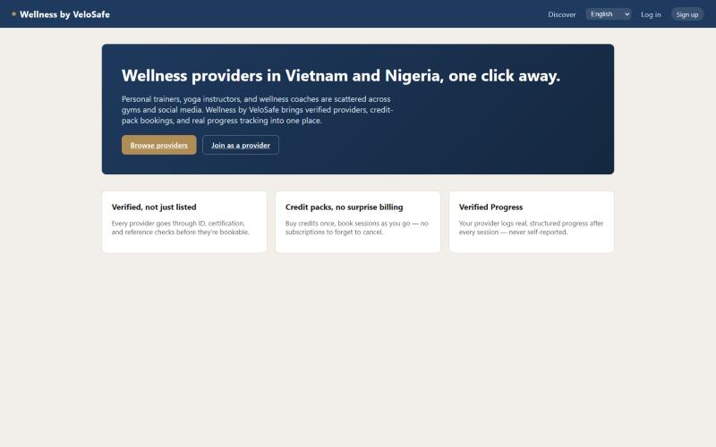
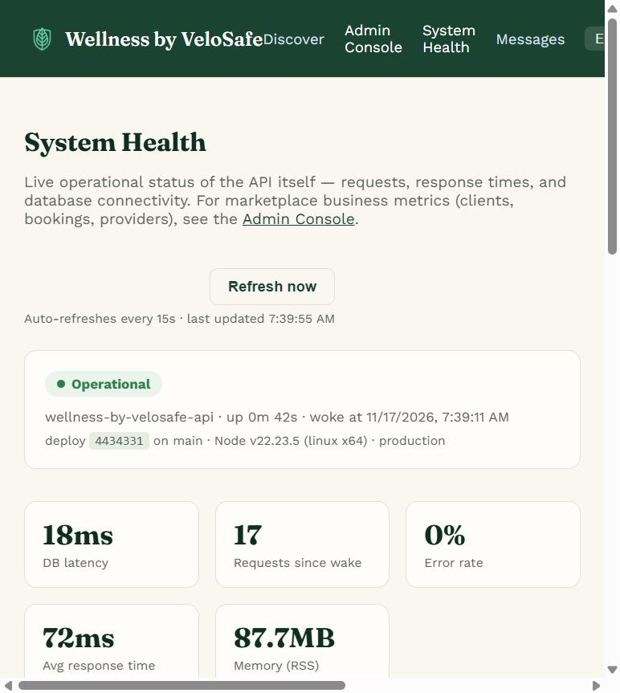

# Wellness by VeloSafe

A wellness-provider marketplace, live in Ho Chi Minh City (Vietnam) and Lagos (Nigeria) —
connecting personal trainers, yoga instructors, and wellness coaches (currently scattered
across gyms and social media) with clients, through verified profiles, prepaid credit-pack
bookings, and provider-logged progress tracking.

Built by **Jeremiah Ndidi Erue**, founder of Velosafe Technologies Ltd —
[LinkedIn](https://www.linkedin.com/in/jeremiah-ndidi-erue).

[](https://wellness-by-velosafe.onrender.com)
[](#tech-stack)
[](#tech-stack)
[](#tech-stack)
[](#tech-stack)
[](#tech-stack)
[](#tech-stack)

## Why this exists

In Ho Chi Minh City and Lagos, independent personal trainers, yoga instructors, and
wellness coaches are easy to find and hard to trust: a few work out of gyms, but most
market themselves through scattered Instagram and Facebook posts, with no consistent way
for a prospective client to verify credentials, see a real track record, or pay for a
session without handing over a phone number first. Wellness by VeloSafe is the trust layer
this space is missing — verified provider profiles, prepaid credit-pack bookings instead of
risky one-off cash transactions, and session-by-session progress tracking that the
**provider** logs, never self-reported by the client. It launches wellness-first in two
markets, built on a category- and country-agnostic data model so expanding into a new
vertical or a new market is a data change, not a rewrite — see `docs/architecture.md`.

## 🔗 Live demo

**App:** **[wellness-by-velosafe.onrender.com](https://wellness-by-velosafe.onrender.com)**
**API:** [wellness-by-velosafe-api.onrender.com/health](https://wellness-by-velosafe-api.onrender.com/health)

Try it with a seeded account — see [Seeded accounts](#seeded-accounts-password-password123-for-all) below
(e.g. `client@example.com` / `password123`), or sign up fresh. The API is on a free instance
that sleeps after ~15 minutes of inactivity, so the first request after a quiet period can
take up to a minute to wake up — that's expected, not a bug.

<table>
  <tr>
    <td width="33%" align="center">
      <br/>
      <sub><b>Homepage</b><br/>Live stats, category tiles, Wellness AI</sub>
    </td>
    <td width="33%" align="center">
      <br/>
      <sub><b>Discover</b><br/>Category browsing, verified providers</sub>
    </td>
    <td width="33%" align="center">
      <br/>
      <sub><b>System Health</b><br/>Live backend operations dashboard</sub>
    </td>
  </tr>
</table>

## What's real in this MVP

- **Accounts & auth** — JWT-based, client/provider/admin roles.
- **Two live markets, built to extend further** — Vietnam and Nigeria both have real
  providers, services, and credit packs in their own currency (VND/NGN). `Country` is a
  first-class, data-driven model (like `ServiceCategory`), so adding a third market is a
  data change, not a rewrite — see `docs/architecture.md`.
- **4 languages in the UI** — English, Vietnamese, Chinese, and French, via `react-i18next`.
  Navigation, the home page, auth, and discovery are fully translated; the rest of the app
  is English-only for now. See the coverage note in `docs/architecture.md` — these
  translations are machine-generated and need native-speaker review before a real launch.
- **Provider discovery** — search/filter by market, category, and keyword.
- **3-tier verification (Tier 1 live)** — ID + certification + reference contact + signed
  code of conduct, confirmed by an admin before a provider is bookable with full trust.
- **Admin Console & System Health dashboard** — a marketplace stats overview and the
  Tier-1 verification workflow for admins at `/admin`, plus a real backend operations
  dashboard at `/admin/ops` (request volume, error rate, response times, database
  connectivity, memory, deployment info) — see `docs/architecture.md` for how it's built
  and its one honest limitation (in-memory, resets on restart).
- **Credit-pack bookings, scoped per market** — buy a pack in VND or NGN, book sessions
  against that market's balance, cancel for a refund. No subscriptions (the payment rails
  this will eventually run on don't reliably support recurring billing for a merchant in
  Velosafe's position — see `docs/architecture.md`).
- **Progress & Goals engine** — providers log a structured, client-visible report after
  each session, including a *transparent, explainable* recommendation for how many more
  sessions make sense — never a black-box score.
- **In-app messaging** — text-only pre-booking with contact-detail filtering (phone/email/
  social handles are soft-blocked, not silently delivered); fuller messaging unlocks once a
  booking is confirmed.
- **Payments** — a real adapter interface with a working mock provider for both markets.
  See `docs/architecture.md` for exactly why MoMo/ZaloPay/VNPay and Paystack/Flutterwave
  aren't live yet (and why Nigeria is actually the closer one) and how they slot in later.

## What's intentionally out of scope for v1

Remote Body Doubling (async accountability pairing), masked in-app calling, Tier 2/3
verification workflows, and a hosted chat SDK migration are all specified in the project's
strategy docs but deliberately staged for after the wellness core proves itself. This is
sequencing discipline, not an oversight — see `docs/architecture.md`.

## Tech stack

- **Backend:** Node.js + TypeScript, Express, Prisma ORM, PostgreSQL.
- **Frontend:** React + Vite + TypeScript.
- **Infra:** docker-compose for Postgres (+ optionally the backend itself); deployed on
  Render (web services) and Supabase (managed Postgres).

## Running it locally

### Option A — with Docker

```bash
docker compose up -d db          # starts Postgres only
cd backend
cp .env.example .env
npm install
npx prisma migrate dev --name init
npm run seed
npm run dev                      # API on :4000
```

```bash
# in a second terminal
cd frontend
npm install
npm run dev                      # app on :5173, proxies /api to :4000
```

### Option B — without Docker

Point `DATABASE_URL` in `backend/.env` at any reachable Postgres instance (a local
install, or a free instance on Neon/Supabase), then follow the same backend/frontend steps
above.

### Seeded accounts (password `password123` for all)

| Email | Role |
|---|---|
| `client@example.com` | Client — has 8 VND credits, a completed booking with progress logged, and an open conversation |
| `mai.tran@example.com` | Provider — Yoga, Ho Chi Minh City, Tier 1 verified |
| `duc.nguyen@example.com` | Provider — Strength coaching, Ho Chi Minh City, Tier 1 verified |
| `chioma.okafor@example.com` | Provider — HIIT & nutrition, Lagos, Tier 1 verified |
| `admin@wellnessbyvelosafe.app` | Admin — can confirm provider verification via `PATCH /api/providers/:id/verification`, and view System Health at `/admin/ops` |

## Project structure

```
backend/     Express API, Prisma schema, seed script
frontend/    React app (discovery, booking, dashboards, messaging)
docs/        Architecture notes and the build plan this MVP was built from
```

## Docs

- `docs/architecture.md` — the product and technical architecture this MVP implements,
  and the honest reasoning behind the choices that aren't fully "real" yet (payments,
  verification tiers 2/3).
- `docs/mvp-build-plan.md` — the planning doc this build started from.

## About

Built by **Jeremiah Ndidi Erue**, founder of Velosafe Technologies Ltd.

Interested in the product, the architecture, or a conversation about either —
[let's connect on LinkedIn](https://www.linkedin.com/in/jeremiah-ndidi-erue).
